  
  
  
  

 

## Sobre mim

 

## Stack

  

 

## Números

  
  

  

 

## Contribuições

<picture>
  <source media="(prefers-color-scheme: dark)" srcset="https://raw.githubusercontent.com/mneabraaolins/mneabraaolins/output/snake-dark.svg" />
  
</picture>

 

